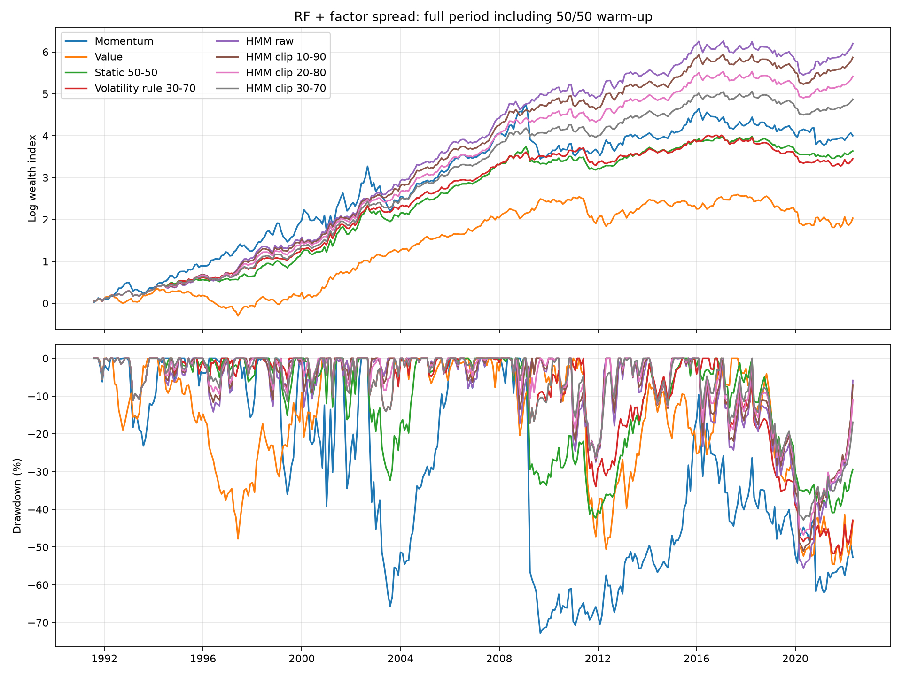
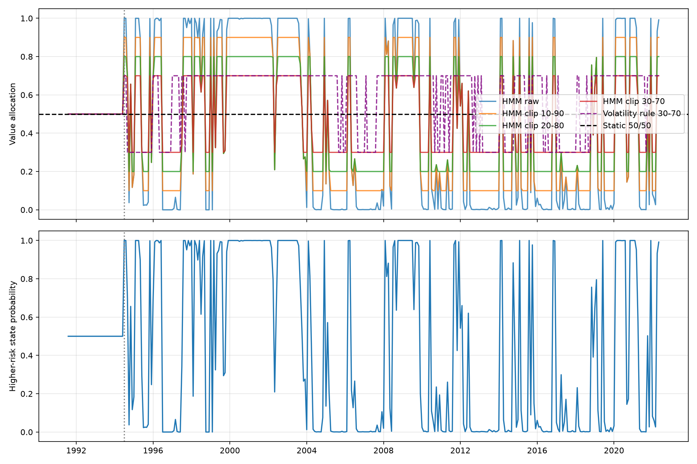
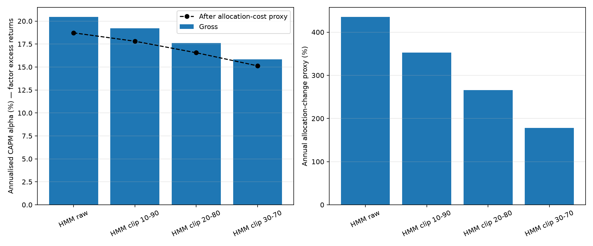

# Regime-Based Allocation Between Momentum and Value

An academic Python research project investigating whether a Gaussian Hidden Markov Model (HMM) can improve allocation between long–short momentum and value portfolios compared with static weighting and a simple volatility rule.

## Approach

- **Momentum:** value-weighted top-minus-bottom decile portfolios sorted on an 11-month cumulative return. The supplied measure includes its observation month; a two-calendar-month lag excludes the most recent month when assigning the holding-month portfolio.
- **Value:** value-weighted high-minus-low book-to-market deciles, formed each July. Annual characteristics are assumed available in July following the fiscal year.
- **Portfolio weights:** market capitalisation is lagged by one calendar month. Missing stock-month observations are not treated as consecutive calendar months.
- **HMM inputs:** lagged cross-sectional average stock return, average idiosyncratic volatility and return dispersion.
- **Estimation:** two Gaussian states, full covariance matrices, expanding training sample, initial 36 observations, annual refitting and random seed 42. Scaling uses training observations only.
- **State identification:** the decoded training state with the larger sum of average idiosyncratic volatility and dispersion is labelled higher risk. This label describes the model inputs; it does not guarantee an economic recession.
- **Allocation:** the estimated higher-risk state probability determines the value weight; momentum receives the remainder. Each probability is taken from the final observation of a sequence containing only information available at that decision date.
- **Warm-up:** initial training observations retain 50/50 allocations. There are 35 warm-up months in the final aligned evaluation sample.

## Comparisons

Momentum alone, value alone, static 50/50, the raw HMM, and HMM allocations clipped to 10–90%, 20–80% and 30–70%.

The heuristic benchmark holds 70% value when lagged average idiosyncratic volatility exceeds the median of the initial 36 input observations, and 30% otherwise. Its threshold remains fixed; warm-up allocations are 50/50.

## Results

Common sample: August 1991–May 2022, 370 monthly observations, including warm-up. Percentages are rounded. These are exploratory historical results, not forecasts.

| Strategy | Annual CAPM alpha | Annual volatility | Sharpe | Maximum drawdown |
|---|---:|---:|---:|---:|
| Momentum | 20.18% | 31.02% | 0.508 | −72.83% |
| Value | 4.41% | 18.64% | 0.326 | −54.51% |
| Static 50/50 | 12.29% | 16.39% | 0.666 | −42.28% |
| Volatility rule | 10.39% | 14.95% | 0.675 | −52.21% |
| HMM raw | 20.47% | 20.63% | 0.975 | −55.63% |
| HMM clipped 10–90 | 19.22% | 18.76% | 0.995 | −51.06% |
| HMM clipped 20–80 | 17.62% | 17.09% | 0.987 | −46.79% |
| HMM clipped 30–70 | 15.84% | 16.01% | 0.931 | −42.83% |

The HMM improved historical risk-adjusted performance relative to the comparison rules. Clipping reduced allocation changes and risk while giving up some return. Drawdown protection was uneven: favouring value cushioned the April 2009 momentum loss, but the raw HMM's full value allocation lost 23.25% in March 2020.





## Performance convention

The weighted long–short factor spread is treated as excess return. Total return is `RF + factor spread`, assuming one unit of capital earns RF and supports one unit of long exposure and one unit of short exposure, before offsetting overlapping positions.

Sharpe uses the mean and standard deviation of the monthly spread, annualised by √12. CAPM regresses the spread on the market excess return; annual alpha is 12 times the monthly intercept. The appraisal ratio divides monthly alpha by residual standard deviation and multiplies by √12. It is not an information ratio against static weighting. Wealth and drawdown compound total returns, including initial wealth of one.

The cost sensitivity applies 40 basis points to the sum of absolute changes in the two factor weights. Opening trades are excluded. This is an allocation-change proxy, not complete stock-level turnover or implementation cost.

## Data and limitations

The stock dataset contains companies from Belgium, France and the Netherlands, with monthly stock data and annual firm characteristics. European factor returns are used for performance evaluation.

The dataset was provided as course material and cannot be included in this repository. The code and results are shared, but reproducing the reported results requires access to the original data.

- Original idiosyncratic-volatility construction and point-in-time availability are unverified; the input is lagged one month.
- July availability of annual accounting data is an assumption.
- Clipping was explored after inspecting results; these comparisons are not an untouched validation sample.
- Expanding-window HMM predictions use historical training data, but this does not remove selection effects in the broader research design.
- Financing, collateral, stock reconstitution, short borrowing and market impact are simplified or omitted. Static allocations having zero allocation-change proxy does not imply zero trading costs.
- State identification adds two raw measures with potentially different scales. Extreme inferred probabilities do not establish calibrated confidence.
- Reported CAPM inference uses HC0; √12 annualisation does not account for serial correlation.

## Run locally

Use a Python virtual environment. The dependency versions in `requirements.txt` match the environment used to run this analysis.

```bash
python -m venv .venv
# Activate the environment for your operating system.
python -m pip install -r requirements.txt
python analysis.py
```

Place these files in a local `data/` directory, or set `HMM_DATA_DIR` to their directory:

| File | Required columns |
|---|---|
| `NL_FR_BE_data_monthly.csv` | `ISIN`, `mdate`, `ME`, `RET`, `RET11`, `ivol` |
| `NL_FR_BE_data_annual.csv` | `ISIN`, `fyear`, `BEME`, `OP`, `INV` |
| `Europe_FF_Factors.csv` | `mdate`, `MktRF`, `RF` |

Monthly dates use `YYYYMM`; returns use decimals. The original course data are required to reproduce the reported results; this repository does not download substitute data.

The script saves tables, regression reports, diagnostics, figures and analysis notes in `hmm_analysis_results/`. Set `HMM_SHOW_PLOTS=0` to save figures without opening windows. Review warnings and fit diagnostics when rerunning.

## Author

Robert Matei — [GitHub](https://github.com/robertmatei42)

Originally developed as a March 2026 academic project. This repository documents the revised implementation and exploratory comparisons.

## Acknowledgements

The research idea, original implementation and analysis were developed by me. OpenAI Codex assisted with code refactoring, documentation and revisions to performance calculations during preparation of this repository.
